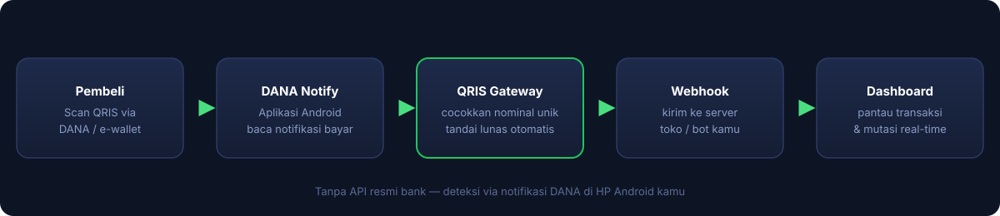

<p align="center">
  
</p>

<h1 align="center">QRIS Gateway</h1>

<p align="center">
  <b>Gateway pembayaran QRIS otomatis untuk Indonesia</b><br>
  Buat kode QRIS dinamis, terima pembayaran otomatis, kelola semua dari dashboard web.
</p>

<p align="center">
  
  
  
  
</p>

<p align="center">
  <a href="https://github.com/Moh-Firman/qris-gateway/raw/main/dana-notify.apk"><b>📱 Download APK DANA Notify</b></a>
  &nbsp;•&nbsp;
  <a href="https://qris-gateway-demo-4exfq13we-fanxyzxd-iis-projects.vercel.app/"><b>🖥️ Live Demo Dashboard</b></a>
</p>

---

## 🖥️ Live Demo

Coba dashboard langsung tanpa install — data contoh, tidak ada transaksi sungguhan:

**[qris-gateway-demo-4exfq13we-fanxyzxd-iis-projects.vercel.app](https://qris-gateway-demo-4exfq13we-fanxyzxd-iis-projects.vercel.app/)**

Login demo: username `demo` / password `demo123` (terisi otomatis).

> File demo dibuat dari `build_demo.py` (dashboard asli + mock API). Untuk update demo: `python3 build_demo.py` lalu deploy ulang folder `demo/` ke Vercel.

---

## 🖼️ Cara Kerja

<p align="center">
  
</p>

```
1. User buat topup Rp50.000 di dashboard
         ↓
2. Sistem generate total unik: Rp50.123 (kode unik: 123)
         ↓
3. User scan QR & bayar tepat Rp50.123 via DANA/OVO/GoPay/m-banking
         ↓
4. Aplikasi DANA Notify di HP mendeteksi notifikasi pembayaran
         ↓
5. Notifikasi dikirim ke gateway → cocokkan nominal
         ↓
6. Transaksi otomatis ditandai LUNAS ✅
```

**Kenapa kode unik?** Karena notifikasi DANA hanya berisi nominal tanpa nama pengirim. Kode unik 3 digit memastikan setiap pembayaran bisa dicocokkan ke transaksi yang benar.

---

## ✨ Fitur

| Fitur | Keterangan |
|-------|-----------|
| 🔢 QRIS Dinamis | Setiap transaksi dapat kode unik 3 digit untuk deteksi otomatis |
| ⚡ Auto-Detect | Saldo masuk otomatis setelah bayar, tanpa konfirmasi manual |
| 🖼️ QRIS Statis | QR tetap untuk dipajang (khusus admin) |
| ⏱️ Auto-Expire | Transaksi pending >30 menit otomatis kadaluarsa |
| 📊 Dashboard | KPI, grafik volume 7 hari, distribusi status |
| 🔔 Log Notifikasi | Semua notifikasi DANA tercatat dan bisa dipantau |
| 🔌 API Lengkap | 7+ endpoint dengan contoh cURL, JS, Python, PHP |
| 📱 Responsif | Tampilan menyesuaikan HP, tablet, desktop |

---

## 📦 Daftar Isi

- [Tentang](#tentang)
- [Kebutuhan](#kebutuhan)
- [Instalasi](#instalasi)
- [Penggunaan](#penggunaan)
- [Dokumentasi API](#dokumentasi-api)
- [Keamanan](#keamanan)
- [Troubleshooting](#troubleshooting)
- [FAQ](#faq)
- [Lisensi](#lisensi)

---

## Tentang

QRIS Gateway adalah sistem pembayaran mandiri yang mengubah satu akun QRIS/DANA menjadi gateway pembayaran otomatis dengan kode unik per transaksi.

**Cocok untuk:**
- Toko online yang butuh pembayaran QRIS otomatis
- Jasa top-up / voucher
- Donasi / crowdfunding
- Sistem billing / langganan
- Yang butuh nama merchant custom tampil di QRIS

**Tidak cocok untuk:**
- Yang butuh settlement ke banyak rekening berbeda (satu akun DANA = satu tujuan)

---

## Kebutuhan

### 🖥️ Server (VPS)

- OS: Ubuntu 20.04+ / Debian 11+
- RAM: minimal 512MB
- Python 3.8+
- Port 8090 terbuka (atau via reverse proxy)
- Domain + HTTPS (disarankan via Cloudflare)

### 📱 HP Android (untuk deteksi otomatis)

- Android 8.0+
- Aplikasi DANA terinstall & login
- Aplikasi DANA Notify ([download di sini](https://github.com/Moh-Firman/qris-gateway/raw/main/dana-notify.apk))
- Koneksi internet stabil

---

### 📱 Aplikasi DANA Notify

Aplikasi Android yang membaca notifikasi pembayaran DANA dan meneruskannya ke gateway secara otomatis.

<p align="center">
  
</p>

**Yang dilakukan aplikasi:**
- Membaca notifikasi "Kamu menerima Rp..." dari aplikasi DANA
- Mengirim nominal + waktu ke webhook gateway (`/api/mutasi_notify`)
- Tanpa root, tanpa akses SMS — hanya izin baca notifikasi

**Download:** [dana-notify.apk](https://github.com/Moh-Firman/qris-gateway/raw/main/dana-notify.apk)

---

## Instalasi

```bash
curl -fsSL https://raw.githubusercontent.com/Moh-Firman/qris-gateway/main/install.sh | sudo bash
```

Installer akan menanyakan **domain** kamu (misal: `eg.domain.com`):
- **Diisi** → otomatis pasang HTTPS (Let's Encrypt via Caddy), dashboard + dokumentasi API langsung pakai domain itu
- **Dikosongkan** → jalan via IP publik VPS

> Pastikan DNS A record domain sudah mengarah ke IP VPS sebelum install.

---

## Penggunaan

### 💰 Buat Topup

1. Login sebagai admin
2. Bagian **Topup Saldo** → pilih nominal atau isi custom
3. (Opsional) isi nama merchant tampil di QR
4. Klik **Buat QRIS** → QR muncul dengan total unik
5. Bayar tepat sesuai total (termasuk kode unik)
6. Status otomatis berubah jadi lunas dalam beberapa detik

### 🖼️ QRIS Statis

1. Bagian **QRIS Statis** → klik **Pilih File**
2. Upload foto QRIS dari DANA Bisnis
3. Sistem otomatis baca kode QR dari gambar
4. Klik **Simpan**

### 📋 Lihat Transaksi

Bagian **Transaksi** menampilkan semua transaksi dengan filter status. Klik **Muat Ulang** untuk refresh.

> **Catatan:** Kolom pengguna dikosongkan untuk privasi. Hanya nominal, waktu, dan status yang tampil.

### 🔔 Log Notifikasi

Klik ikon **lonceng** di topbar untuk melihat semua notifikasi masuk dari aplikasi DANA Notify, termasuk yang tidak cocok dengan transaksi manapun.

---

## Dokumentasi API

Base URL: `https://gateway.example.com/api`

Semua endpoint memakai `POST` dengan JSON body. Dokumentasi lengkap dengan contoh kode (cURL, JavaScript, Python, PHP) tersedia di dashboard setelah login, bagian **Dokumentasi API**.

### Endpoint Utama

| Endpoint | Auth | Keterangan |
|----------|------|-----------|
| `/api/topup_create` | Session | Buat topup QRIS dinamis |
| `/api/topup_confirm` | Session | Cek status pembayaran |
| `/api/topup_cancel` | Session | Batalkan topup |
| `/api/topup_list` | Session | Riwayat transaksi |
| `/api/balance_get` | Session | Cek saldo |
| `/api/internal_create` | Secret | Buat topup (server-to-server) |
| `/api/internal_status` | Secret | Cek status (server-to-server) |
| `/api/mutasi_notify` | Secret | Terima notifikasi DANA |

### Contoh: Buat Topup via API

```bash
curl -X POST https://gateway.example.com/api/internal_create \
  -H "Content-Type: application/json" \
  -d '{"secret": "SECRET_ANDA", "user_id": 1, "amount": 50000}'
```

Response:
```json
{
  "ok": true,
  "id": 123,
  "qris_string": "000201010212...",
  "total": 50123,
  "unique_code": 123
}
```

---

## Keamanan

- **Rate limiting**: 10 request/menit per IP (15/menit untuk endpoint sensitif)
- **Anti brute-force**: login diblokir 15 menit setelah 5x gagal (per username + per IP)
- **Timing-safe compare**: secret & password hash dicek dengan `hmac.compare_digest`
- **Batas payload**: request >2MB ditolak (anti memory-exhaustion)
- **Session**: cookie HttpOnly + Secure + SameSite
- **Password**: PBKDF2-HMAC-SHA256, 100.000 iterasi, salt per-user
- **Security headers**: X-Frame-Options, X-Content-Type-Options, Referrer-Policy, Content-Security-Policy
- **Anti-intip**: klik kanan, F12, Ctrl+U diblokir di frontend
- **Role-based**: non-admin tidak bisa akses fitur apapun

> **Penting:**
> - Ganti kredensial admin default segera setelah install
> - Jangan bagikan API secret ke siapapun
> - Gunakan HTTPS (jangan akses via HTTP di production)
> - Backup database `/opt/gateway/gateway.db` secara berkala

---

## Troubleshooting

### Gateway tidak jalan

```bash
sudo systemctl status qris-gateway
sudo journalctl -u qris-gateway -n 50
```

### Notifikasi tidak masuk

1. Cek aplikasi DANA Notify: webhook URL benar? secret cocok?
2. Cek izin notifikasi di HP sudah diberikan?
3. Tes dari aplikasi, lalu cek Log Notifikasi di dashboard
4. Cek log server: `sudo journalctl -u qris-gateway | grep NOTIFY`

### Pembayaran tidak otomatis lunas

1. Pastikan nominal **tepat** sama dengan total unik (termasuk 3 digit kode)
2. Cek Log Notifikasi: apakah notifikasi masuk?
3. Jika notifikasi masuk tapi tidak cocok → nominal salah

### Lupa password admin

```bash
# Reset via database (ganti 'admin' dengan username)
sudo python3 -c "
import sqlite3, os, hashlib
db = sqlite3.connect('/opt/gateway/gateway.db')
salt = os.urandom(16).hex()
pw = hashlib.sha256(('passwordbaru' + salt).encode()).hexdigest()
db.execute('UPDATE users SET pw_hash=?, salt=? WHERE username=?', (pw, salt, 'admin'))
db.commit()
print('Password direset')
"
```

---

## FAQ

**Q: Apakah nama merchant tampil di aplikasi pembayaran?**
A: Tidak. Aplikasi pembayaran (DANA/OVO/GoPay) menampilkan nama terdaftar akun DANA Bisnis, bukan nama dari QR. Ini keterbatasan DANA.

**Q: Bisa untuk banyak merchant?**
A: Satu gateway = satu akun DANA tujuan. Untuk banyak merchant, setiap merchant butuh gateway + HP + akun DANA sendiri.

**Q: Apakah aman dari penipuan?**
A: Sistem mencocokkan nominal unik. Selama kode unik tidak ditebak orang lain, pembayaran teratribusi dengan benar. Jangan bagikan QR yang sama ke banyak orang.

**Q: Berapa biaya operasional?**
A: VPS (~Rp50rb/bulan) + domain (~Rp150rb/tahun). Tidak ada biaya per transaksi dari sistem ini.

---

## Tentang Pembuat

<p>
  
  <b>Moh Firman</b> — Indonesia
</p>

Dibuat untuk kebutuhan pribadi yang kemudian di-open source agar bermanfaat untuk orang lain.

---

## Lisensi

MIT License — bebas dipakai, dimodifikasi, dan didistribusikan untuk keperluan apapun.

---

<p align="center">
  Dibuat dengan teliti di Indonesia 🇮🇩
</p>
